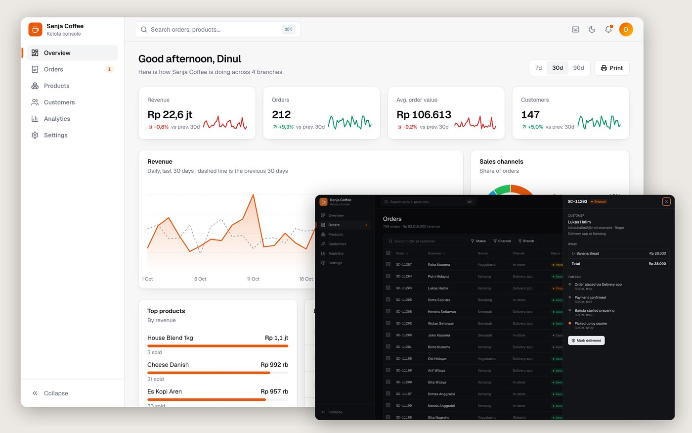

# Kelola: admin console

[](https://github.com/dinulimann/kelola-dashboard/actions/workflows/ci.yml)

**Live demo:** https://kelola-dashboard.vercel.app



An admin console for **Senja Coffee**, a fictional four-branch coffee chain. It is a UI showcase: there is no backend, and every order, product and customer is generated in the browser from a fixed seed. Changes you make are saved in `localStorage`, and **Settings → Demo data** puts everything back.

Built with **React 19**, **TypeScript** (strict), **Vite**, **Tailwind CSS 4** and **Motion**, tested with **Playwright**. Charts are hand-written SVG; there is no chart or UI component library.

## What is in it

- **Overview:** KPI cards with sparklines and change against the previous period (7, 30 or 90 days), daily revenue with the previous period as a dashed line and a hover tooltip, a channel donut, top products and the latest orders.
- **Orders:** 759 orders with search, multi-select filters for status, channel and branch, sorting, pagination, column visibility and a compact density. Filters, sort, page and the open order are kept in the URL, so a filtered view can be reloaded or shared. Select rows to mark them shipped or delivered, export them to CSV, or delete them, with **undo** on every bulk change. Clicking a row opens a drawer with the items and a status timeline.
- **Products:** grid or list view, category chips, a low-stock warning, stock edited inline, a switch to take an item off the menu, and an **Add product** form that checks for duplicates, a cost below the price and shows the margin as you type.
- **Customers:** segments (VIP, Regular, New, At risk) worked out from order history, ranked by spend, with a drawer showing each customer's orders.
- **Analytics:** revenue by weekday and hour as a heatmap, an order funnel, branches compared by revenue, average order, cancellations and channel mix, and gross profit per category.
- **Settings:** store profile with validation, team roles, notification switches and a reset for the demo data.
- **Everywhere:** a command palette (<kbd>⌘K</kbd> or <kbd>/</kbd>) that searches orders, products and customers, keyboard shortcuts (<kbd>g</kbd> then <kbd>o</kbd> for Orders, <kbd>?</kbd> for the list), light and dark mode remembered between visits with no flash on load, a collapsible sidebar, a mobile menu, toasts, and dialogs that trap focus and close with <kbd>Esc</kbd>. Animations are turned off when the system asks for reduced motion.

## Tests

Seven Playwright tests run against the production build on every push: every page renders without console errors, filters survive a reload, a bulk status change can be undone, deleted orders stay deleted until the demo data is reset, the command palette opens an order, the product form rejects bad input and then saves, and dark mode is remembered.

## Run it

Requirements: Node.js 22.

```bash
npm ci
npm run dev          # http://localhost:5173
npm run test:e2e     # builds, serves on :5201 and runs Playwright
```

## Structure

```
src/lib/data.ts          seeded sample data (products, customers, 120 days of orders)
src/lib/store.tsx        reducer, localStorage persistence, toasts with undo
src/lib/router.ts        hash routes and URL query state
src/lib/metrics.ts       KPI and time-series calculations
src/components/          app shell, command palette, charts, buttons, dialogs
src/pages/               Overview, Orders, Products, Customers, Analytics, Settings
tests/                   Playwright tests
```

Senja Coffee is not a real business. Built by Dinul Iman.
